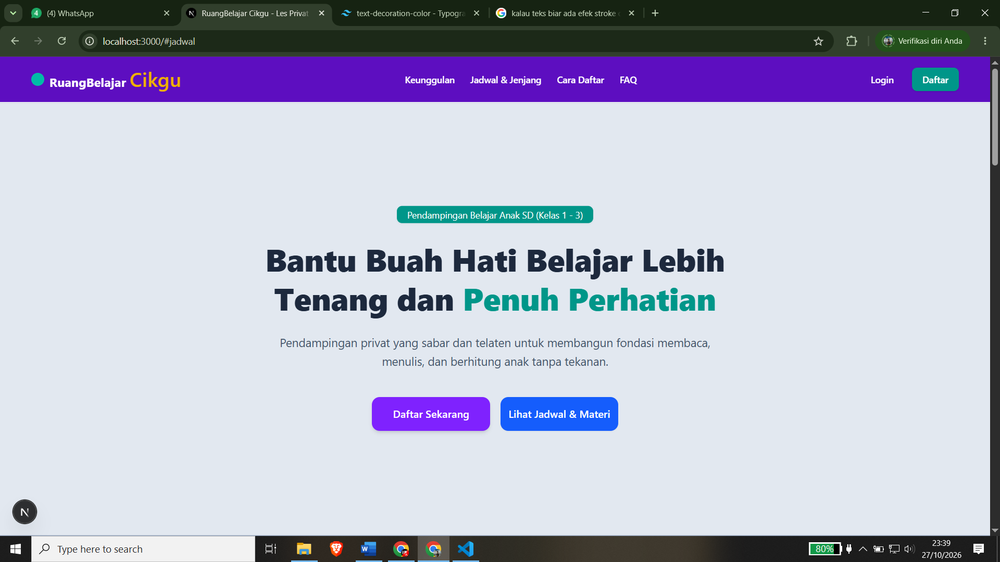
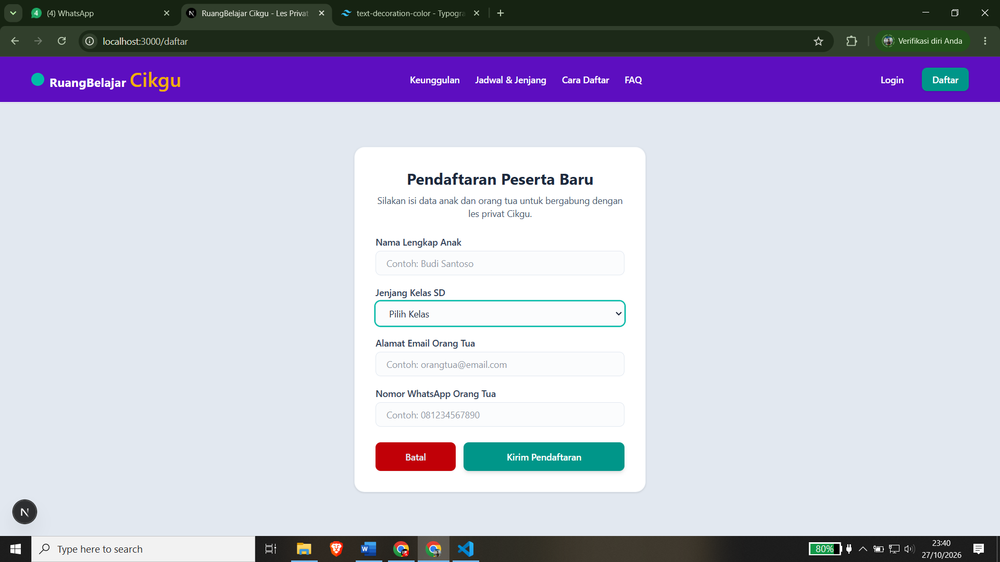
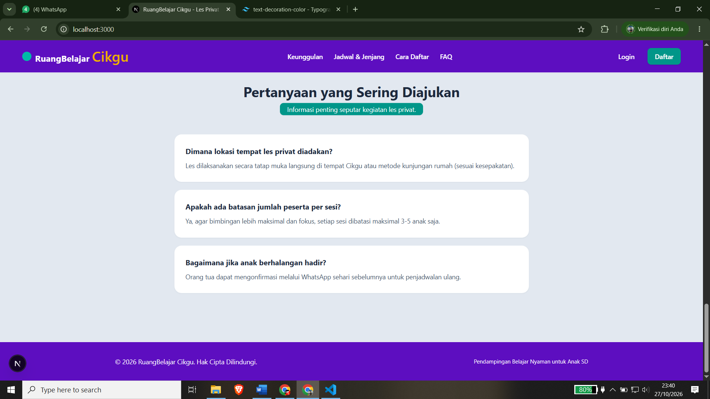

# 📚 RuangBelajar Cikgu - Landing Page & Web App MVP

Aplikasi web pendampingan les privat untuk siswa SD (Kelas 1 - 3) berbasis **Next.js (App Router)** dan **Tailwind CSS**. Didesain khusus dengan pendekatan *mobile-first*, antarmuka yang ramah di mata (*light-mode design*), serta tata letak modular yang responsif.

---

## 🖼️ Tampilan Aplikasi

### 1. Landing Page Utama

### 2. Form Pendaftaran (/daftar)

### 3. FAQ & Informasi

---

## 🚀 Fitur Utama

- **Landing Page Responsif**: Tampilan modern dan ramah anak dengan *layout zebra-striping* (selang-seling warna section) dan navbar *sticky*.
- **Formulir Pendaftaran (`/daftar`)**: Form pendaftaran siswa baru yang mengumpulkan data nama anak, jenjang kelas, email, dan nomor WhatsApp orang tua dilengkapi tombol navigasi batal.
- **Halaman Login (`/login`)**: Akses portal masuk untuk Cikgu (admin) dan orang tua murid.
- **Desain Ramah Mata**: Menggunakan palet warna slate dan tosca/teal untuk menjaga kenyamanan visual pengguna.

---

## 🛠️ Teknologi yang Digunakan

- **Framework**: [Next.js 15](https://nextjs.org/) (App Router)
- **Styling**: [Tailwind CSS v4](https://tailwindcss.com/)
- **Language**: TypeScript
- **Icons & Typography**: Font Geist Sans & Geist Mono

---

## 💻 Cara Menjalankan Proyek Secara Lokal

Jika ingin menjalankan proyek ini di komputer lokal, ikuti langkah-langkah berikut:

1. Clone repository ini:
   git clone https://github.com/Pramana19/ruangbelajar-cikgu.git
   cd ruangbelajar-cikgu

2. Install dependensi:
   npm install

3. Jalankan server pengembangan:
   npm run dev

4. Buka di browser:
   Akses http://localhost:3000 untuk melihat hasilnya di browser.

---

© 2026 RuangBelajar Cikgu. Hak Cipta Dilindungi.